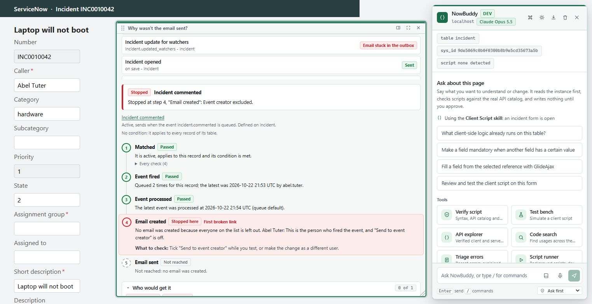
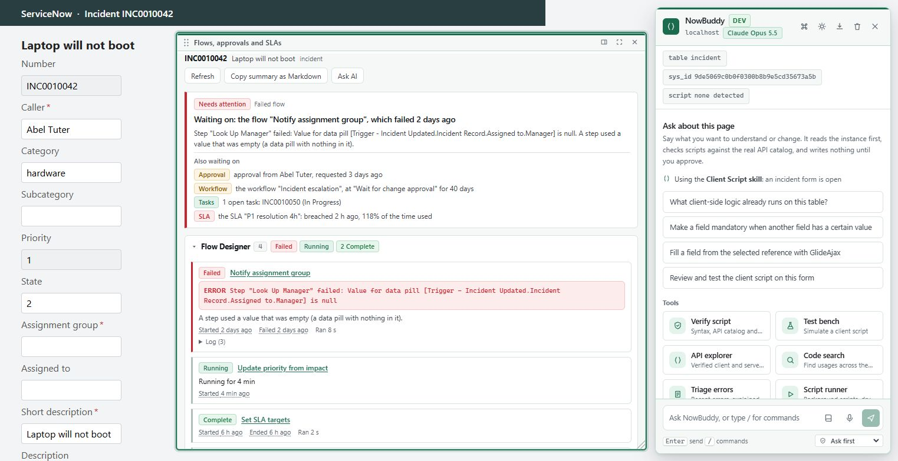
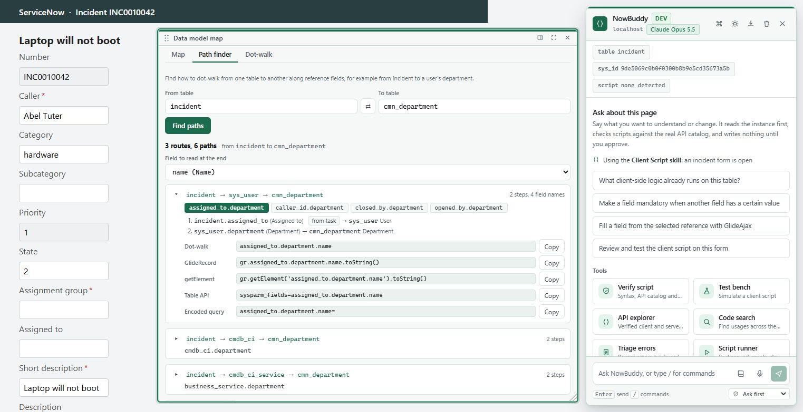

# NowBuddy: a five-minute demo

A ServiceNow developer's toolkit that lives on the instance page. You describe the problem, it finds the tool, and
the checks that do not need an AI run locally for free.

**One sentence:** press `Ctrl+Shift+Space`, say what you are trying to do, and get the answer on the page you are
already on.

## What to show, in order

Each step is a thing a developer does every week. Use a dev or PDI instance, and open a **Script Include** or a
**Business Rule** first, because that page shows the most.

Steps 1 to 9 take about eight minutes. For five, run **1, 2, 4, 7, 8 and 9**; steps 3, 5 and 6 are the extras for when
there is time. Steps 7 to 9 are the tools added in 0.9: run the matching sections of
[LIVE_CHECK.md](LIVE_CHECK.md) on the demo instance first, so you know what it will show.

### 1. Say what you need, not what the tool is called (30 seconds)

Open the palette on a script. The first group is **Suggested for this script**: the editor, Verify, Lint and
Change impact, because that is what you reach for on a script. On a list it suggests Explain and Count instead; on an
update set, Ship check.

Then type a problem in your own words:

Try these, each lands on the right tool:

| Type | Lands on |
| --- | --- |
| `who changed this` | Compare versions, audit history |
| `where is this used` | Change impact |
| `why can't a user see this record` | Access debugger |
| `why is this field read only` | Page X-ray |
| `start a new update set` | Create one and switch to it |
| `INC0010001` (any record number) | Opens that record |

`Alt+P` pins the one you keep using.

### 2. Know what a change will touch before you make it (60 seconds)

Run **Change impact** on a Script Include. It lists who calls it, what it writes, and which business rules,
flows and notifications fire as a result, with a risk summary at the top. It reads the instance; it changes nothing.

### 3. Check the script without spending a token (30 seconds)

Use **Verify the script on this form**, or the **Lint** button the extension puts next to every script field. It
checks syntax, the API catalog (a made-up `GlideRecord` method is caught), lint rules and structure. The API
catalog was checked against a real instance, not copied from documentation.

### 4. Understand a form (45 seconds)

Press `Alt+Shift+X` on a form. Every field gets a chip with its type and how many UI policies, client scripts,
business rules and ACLs touch it. Click a chip to see **why** the field is read-only, mandatory or hidden.

On a form label, the **`⋯`** button copies the field name, the value, or the `g_form` or GlideRecord call that reads
it, opens the dictionary entry and shows the ACLs on that field.

### 5. Ship without surprises (60 seconds)

Open **My work**. It shows your update set and scope, and warns when your changes are landing in Default and will not
ship. **New** next to the update set creates a named set and switches to it. **Ship check** reviews a set before you
move it: collisions, missing dependencies, scripts that fail lint, and a release checklist.

### 6. Hand someone a link, a query or a payload (30 seconds)

On any record: copy the Table API URL, a GlideRecord that loads it, or its values as JSON. On any list: explain the
filter in plain words, count the rows, copy the encoded query or the GlideRecord code.

### 7. Find out why an email never arrived (60 seconds)

Open an incident, press `Ctrl+Shift+Space` and type `why was the email not sent` (or `/notify`). Pick a notification
from the list (for example **Incident commented**, or type part of its name) and press **Trace**. It walks the chain **matched, event fired, event processed, email
created, email sent**, marks the first link that broke in one sentence, and lists who would have received the mail and
who was left out and why (inactive user, notifications disabled, no address, the person who fired the event).

A staged example for a dev instance: comment on an incident as the person it is assigned to, then trace **Incident
commented**. If that person is the only recipient, the answer is "Send to event creator is off". What you see depends on
that instance's notifications and on whether email is switched on; the panel says when it cannot tell, and when it
cannot read `sysevent` or `sys_email`. It only reads.

### 8. Find out why a ticket is stuck (45 seconds)

On an incident, change or request that has something running, type `why is this ticket stuck` (or `/flows`). The top
line says what the record is **waiting on**: a failed flow, an approval (from whom, for how long), a workflow
activity, an open child task, a breached SLA, a queued event. Below it are the sections: Flow Designer runs with their
error and log, approvals, SLAs, tasks and legacy workflows. A section it cannot read is named; "Nothing is running"
is only said after every source was read.

### 9. Walk from one table to another (45 seconds)

Type `/path incident cmn_department`. It lists the dot-walk routes (`caller_id.department`, `assigned_to.department`,
and the longer ones through other tables) and, for the one you pick, the dot-walk string, a `GlideRecord` line, a
`getElement` line, a Table API `sysparm_fields` fragment and an encoded-query condition, each with a Copy button. The
**Map** tab (`/map incident`) shows the same table as a diagram: what it extends, its children, what it references and
what references it.

## Where a new user starts

The first time it runs there is a short card. After that, **Developer guide** in the palette lists everything by the job
you are doing, with the page you are on first. Every line is a button that opens the palette with that phrase typed
in.

After an update, a **What's new** card lists the new tools once, by job, for people who already dismissed the first-run
card; "What's new" in the palette opens it again.

## Why it is safe to try on a real instance

- Reads and checks run first and run locally. The AI is only used when you ask for it.
- Writes ask first, name what they change, and are logged with an undo.
- A production-looking instance asks you to type its name before any change.
- The extension uses your own browser session: it can see what you can see, nothing more.

## Before you present

1. Load `dist/` as an unpacked extension (`npm run build`) and reload it after each build.
2. Log in to a dev instance. Do not demo on production.
3. Open the Script Include `AJAXMessagingUtils` (or any custom one that other scripts call) for steps 2 and 3.
4. Open a new Incident (`/incident.do?sys_id=-1`) for step 4. It is a blank form, so nothing is saved.
5. Run **Self-check** (`/doctor`) on the demo instance before the audience arrives, and read what it says. It shows which
   tools have the tables and columns they need there. Do not open it live unless it is green or you can explain the amber.
6. Steps 7 to 9 need an incident (or change) that has an email trail, something running against it, and a signed-in user
   who can read the dictionary. Open the one you will use beforehand and try the three commands once. Those tools were
   built after the last live pass; [LIVE_CHECK.md](LIVE_CHECK.md) is how to confirm them.
7. To replay the first-run card: palette, **Quick tour**. To show the new-tools card: palette, **What's new**.

**About the screenshots.** All of them come from the local preview with fake data (`npm run preview`, then
`?palette=open&scriptform=1`, `?guide=1`, `?open=notify`, `?open=process` and
`?open=datamodel&q=path incident cmn_department`). The incident, notifications, flows and row counts in them are made up.
None is a picture of a real instance, and what your instance shows will differ.
