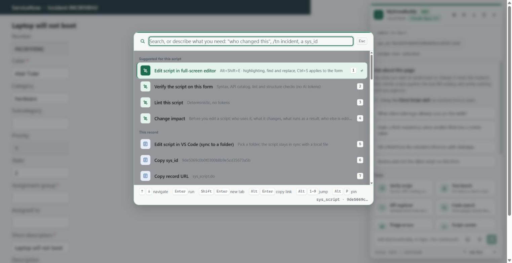
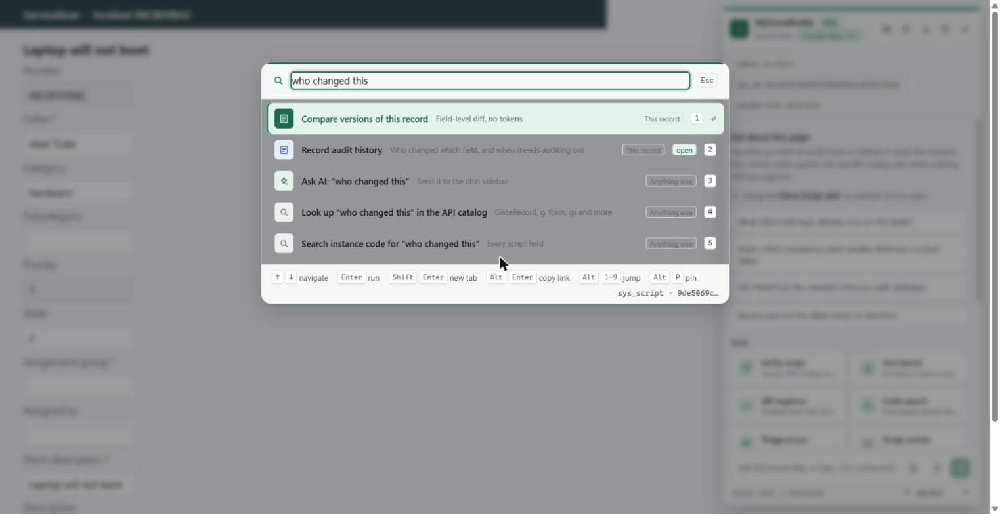
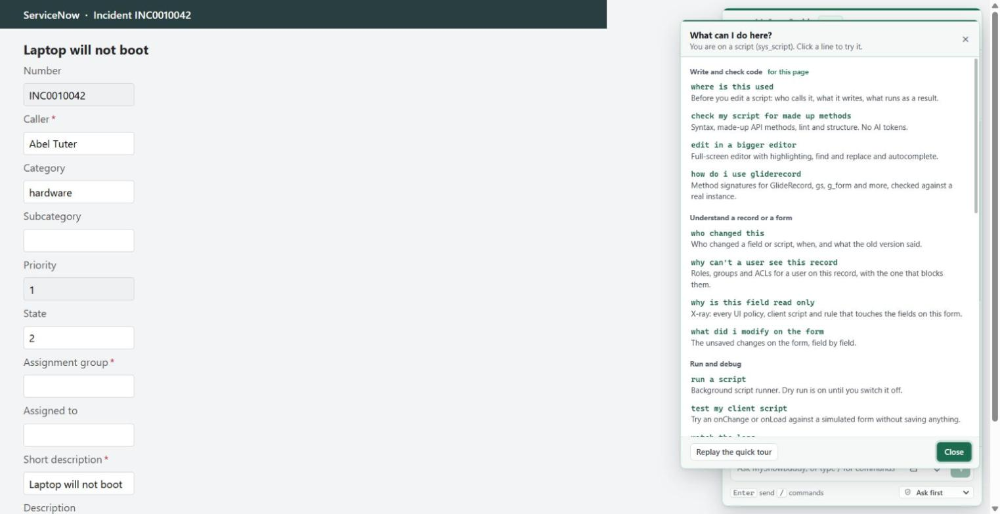

# MySnowBuddy: a five-minute demo

A ServiceNow developer's toolkit that lives on the instance page. You describe the problem, it finds the tool, and
the checks that do not need an AI run locally for free.

**One sentence:** press `Ctrl+Shift+Space`, say what you are trying to do, and get the answer on the page you are
already on.

## What to show, in order

Each step is a thing a developer does every week. Use a dev or PDI instance, and open a **Script Include** or a
**Business Rule** first, because that page shows the most.

### 1. Say what you need, not what the tool is called (30 seconds)

Open the palette on a script. The first group is **Suggested for this script**: the editor, Verify, Lint and
Change impact, because that is what you reach for on a script. On a list it suggests Explain and Count instead; on an
update set, Ship check.

Then type a problem in your own words:

Try these, each lands on the right tool:

| Type | Lands on |
| --- | --- |
| `who changed this` | Compare versions, audit history |
| `where is this used` | Change impact |
| `why can't a user see this record` | Access debugger |
| `why is this field read only` | Page X-ray |
| `start a new update set` | Create one and switch to it |
| `INC0010001` (any record number) | Opens that record |

`Alt+P` pins the one you keep using.

### 2. Know what a change will touch before you make it (60 seconds)

Run **Change impact** on a Script Include. It lists who calls it, what it writes, and which business rules,
flows and notifications fire as a result, with a risk summary at the top. It reads the instance; it changes nothing.

### 3. Check the script without spending a token (30 seconds)

Use **Verify the script on this form**, or the **Lint** button the extension puts next to every script field. It
checks syntax, the API catalog (a made-up `GlideRecord` method is caught), lint rules and structure. The API
catalog was checked against a real instance, not copied from documentation.

### 4. Understand a form (45 seconds)

Press `Alt+Shift+X` on a form. Every field gets a chip with its type and how many UI policies, client scripts,
business rules and ACLs touch it. Click a chip to see **why** the field is read-only, mandatory or hidden.

On a form label, the **`⋯`** button copies the field name, the value, or the `g_form` or GlideRecord call that reads
it, opens the dictionary entry and shows the ACLs on that field.

### 5. Ship without surprises (60 seconds)

Open **My work**. It shows your update set and scope, and warns when your changes are landing in Default and will not
ship. **New** next to the update set creates a named set and switches to it. **Ship check** reviews a set before you
move it: collisions, missing dependencies, scripts that fail lint, and a release checklist.

### 6. Hand someone a link, a query or a payload (30 seconds)

On any record: copy the Table API URL, a GlideRecord that loads it, or its values as JSON. On any list: explain the
filter in plain words, count the rows, copy the encoded query or the GlideRecord code.

## Where a new user starts

The first time it runs there is a short card. After that, **Developer guide** in the palette lists everything by the job
you are doing, with the page you are on first. Every line is a button that opens the palette with that phrase typed
in.

## Why it is safe to try on a real instance

- Reads and checks run first and run locally. The AI is only used when you ask for it.
- Writes ask first, name what they change, and are logged with an undo.
- A production-looking instance asks you to type its name before any change.
- The extension uses your own browser session: it can see what you can see, nothing more.

## Before you present

1. Load `dist/` as an unpacked extension (`npm run build`) and reload it after each build.
2. Log in to a dev instance. Do not demo on production.
3. Open the Script Include `AJAXMessagingUtils` (or any custom one that other scripts call) for steps 2 and 3.
4. Open a new Incident (`/incident.do?sys_id=-1`) for step 4. It is a blank form, so nothing is saved.
5. To replay the first-run card: palette, **Quick tour**.

The screenshots here come from the local preview (`npm run preview`, then `?palette=open&scriptform=1` and `?guide=1`),
which uses a fake incident and no instance data.
